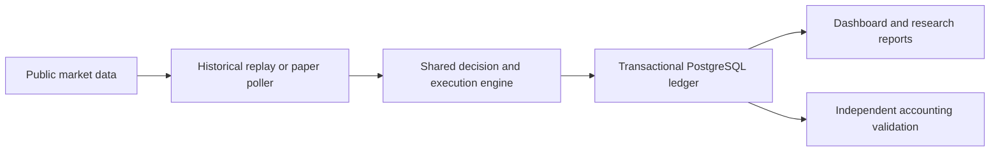

# Crypto Quant Lab V2

A research and paper-trading application for evaluating cryptocurrency strategies with realistic execution costs and independent financial checks. The intended venue is Revolut X. This project does not place real-money orders.

## Capabilities

- Historical strategy evaluation with buy-and-hold benchmarks.
- Decimal accounting for cash, quantities, fees and weighted-average cost basis.
- Depth-aware execution simulation, lot limits, spread/slippage and partial fills.
- PostgreSQL transactions and immutable experiment configuration.
- Dashboard and ledger exports covering returns, costs, exposure and drawdown.
- Prepared forward paper-testing workflow using public market data.

## Current status

Research/development prototype. A seven-day forward paper-test protocol is prepared; this snapshot does not claim that it ran or proved profitability. Live trading is disabled. No API trading keys, account data, credentials, private recovery material or local experiment results are included.

## Design and limitations

The same execution/accounting components support historical replays and paper decisions. Historical order-book depth may be synthetic; forward observations and transaction-cost calibration are needed before economic conclusions. Backtested profit does not establish future performance. Recovery of an encrypted PostgreSQL snapshot on an independent machine has been tested, but this repository is a source showcase, not a complete deployment backup.

## Source layout

`quantv2/` contains the active engine, SQL repository, research workflows and web dashboard. `tests/v2/` contains isolated validation tests. Compose is a development template; configure new local secrets and public input datasets before deploying. No original Git history is included.

## Engineering highlights



## Local development

Create a virtual environment and install `requirements.lock.txt`. Run the core isolated tests with:

```sh
python -m unittest tests.v2.test_execution tests.v2.test_runtime tests.v2.test_backtesting
```

The development Compose template binds to localhost. Generate fresh development credentials and TLS material rather than reusing a server configuration. Market datasets must be provisioned separately; no local research records are published here.

Validation of this public source snapshot: 51 isolated execution, runtime and backtesting tests passed. SQL/service integration checks require a separately provisioned disposable environment.
